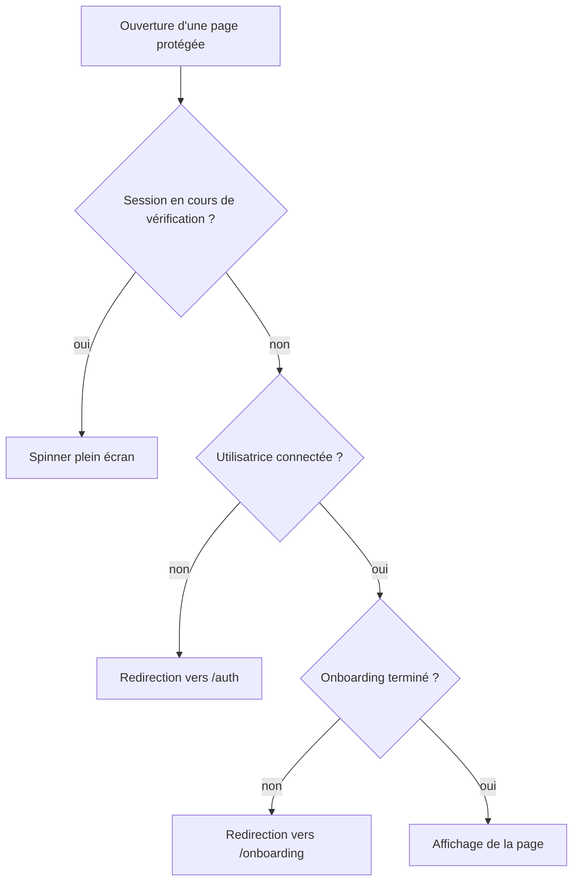
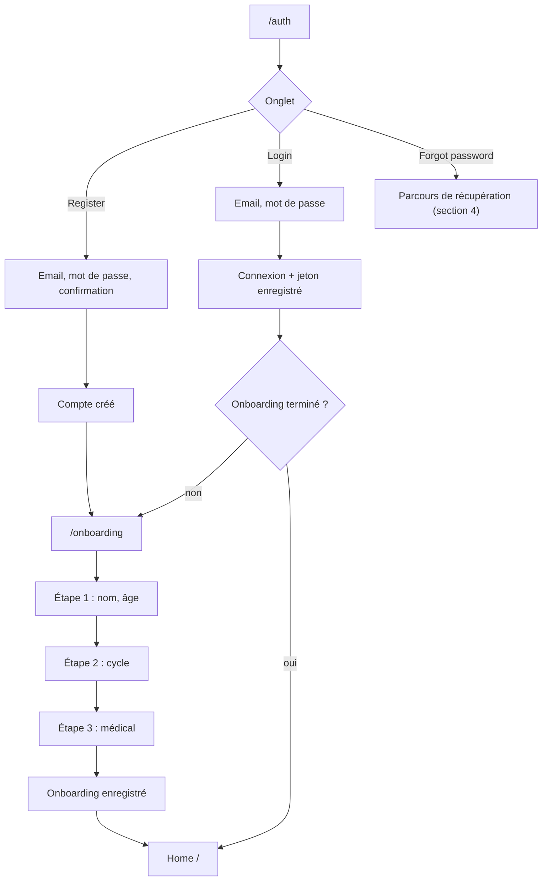
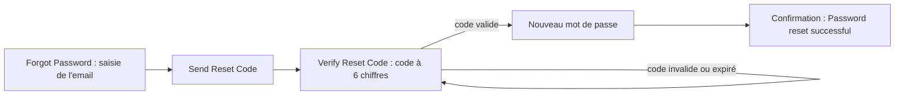
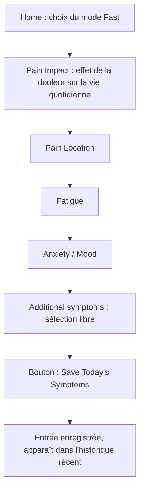
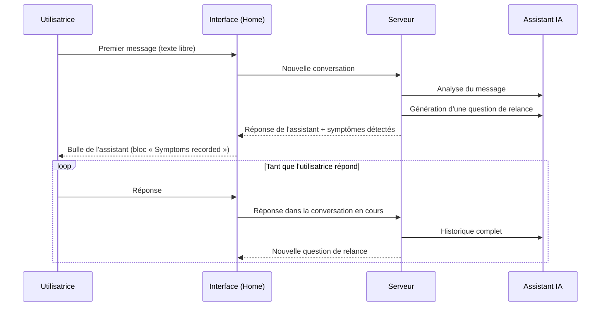
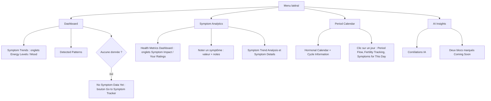
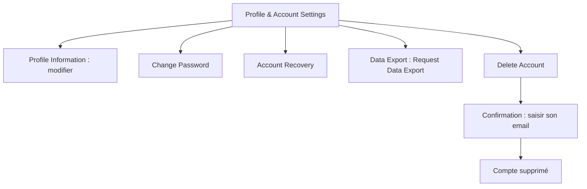

 ENDOless – UX Flows

> Document décrivant les parcours utilisateur **tels qu'ils existent dans le code** (état actuel).
> Sources : `client/src/App.tsx`, `lib/protected-route.tsx`, `hooks/use-auth.tsx`, `components/app-layout.tsx`
> et les pages de `client/src/pages/`. Les maquettes associées sont dans [`mockups.html`](./mockups.html).
>
> Les diagrammes utilisent Mermaid : ils s'affichent directement sur GitHub.

## 1. Carte de navigation

| Écran | Route | Rôle | Accès |
|---|---|---|---|
| Connexion / Inscription | `/auth` | Deux onglets : Login, Register | Public |
| Mot de passe oublié | page dédiée | Réinitialisation en 3 étapes | Public |
| Onboarding | `/onboarding` | Profil de départ en 3 étapes | Connecté |
| Home (chat) | `/` | Saisie des symptômes du jour | Connecté + onboarding terminé |
| Dashboard | `/dashboard` | Tendances (énergie, humeur) et schémas détectés | Connecté + onboarding terminé |
| Symptom Analytics | `/analytics` | Graphiques d'impact, notes de ressenti | Connecté + onboarding terminé |
| Period Calendar | `/calendar` | Cycle, flux, fertilité, symptômes par jour | Connecté + onboarding terminé |
| AI Insights | `/insights` | Corrélations générées par l'IA | Connecté + onboarding terminé |
| Profile | `/profile` | Compte, mot de passe, export, suppression | Connecté + onboarding terminé |

Le menu latéral (`app-layout.tsx`) liste : Home, Dashboard, Symptom Analytics, Period Calendar, AI Insights, Profile, plus un bouton Logout. Il charge aussi les symptômes récents (`/api/symptoms/recent`).

## 2. Garde d'accès (toutes les pages protégées)

## 3. Inscription, connexion, onboarding

**Détail de l'onboarding** (barre de progression « Step N of 3 », bouton Back à partir de l'étape 2) :

| Étape | Titre | Champs |
|---|---|---|
| 1 | Basic Information | Full Name, Age (18 à 100) |
| 2 | Menstrual Cycle Information | Average Cycle Length (21 à 40 jours), Average Period Length (1 à 10 jours), Last Period Start Date |
| 3 | Medical Information | Diagnosed Condition (liste : endométriose, SOP, adénomyose, fibromes, PID, autre, non diagnostiqué, aucune), Common Symptoms (cases à cocher : douleur pelvienne, dos, règles abondantes, fatigue, ballonnements, nausées, maux de tête, humeur, insomnie, troubles intestinaux) |

## 4. Mot de passe oublié

Le message après l'envoi reste volontairement neutre (« If an account exists with this email… ») pour ne pas révéler quels emails sont inscrits.

## 5. Saisir ses symptômes du jour (Home)

La page propose deux modes : *« Choose how you want to track your symptoms today »*.

### 5a. Fast Questions (formulaire structuré)

Aucune IA n'intervient dans ce mode. L'entrée alimente directement les graphiques et les corrélations.

### 5b. Speak Naturally (chat avec l'assistant)

Comportements d'interface observés : champ de saisie désactivé pendant l'attente, message de chargement, défilement automatique vers le bas, placeholder *« Describe how you're feeling today… »*.

## 6. Consulter ses données

## 7. Profil et compte

## 8. Observations UX (pistes pour la suite)

Constats tirés de la lecture du code, à valider en testant l'application :

- **Deux modes de saisie aux effets différents** : seul le mode Fast alimente aujourd'hui les graphiques ; les entrées du chat n'y apparaissent pas de la même façon. Un parcours unifié (le chat remplit le même formulaire) clarifierait l'expérience.
- **Pas de lien explicite entre Home et les résultats** : après « Save Today's Symptoms », rien n'oriente vers Dashboard ou Analytics.
- **Insights en chantier** : deux blocs « Coming Soon » sur AI Insights, à traiter comme des états à concevoir.
- **Textes d'interface en anglais uniquement** : à prévoir si le public cible est francophone.
- **Erreurs IA silencieuses** : en cas d'échec de l'assistant, une phrase générique est présentée comme une vraie réponse. Un état d'erreur explicite (« L'assistant n'a pas pu répondre, réessaie ») serait plus honnête.
- **Données sensibles** : les écrans Profil (export, suppression) sont bien présents ; leur visibilité et leur formulation comptent pour la confiance des utilisatrices.
