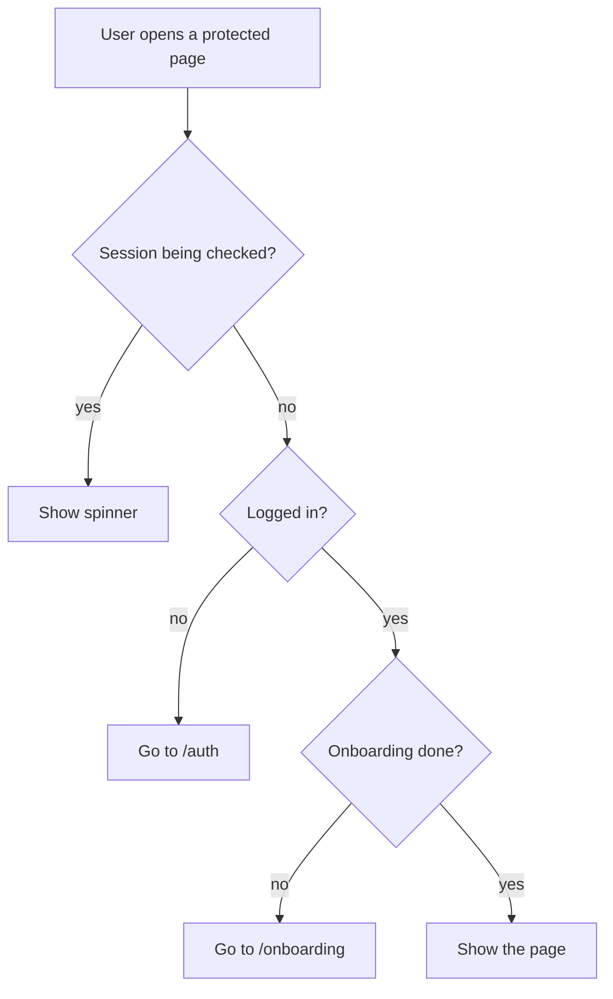
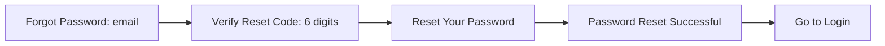
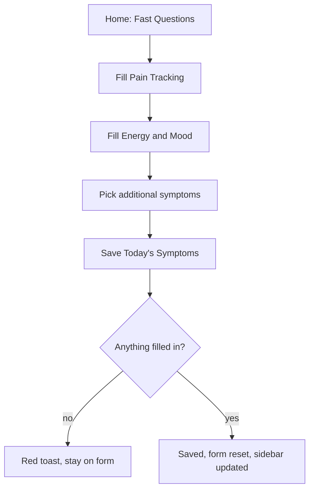
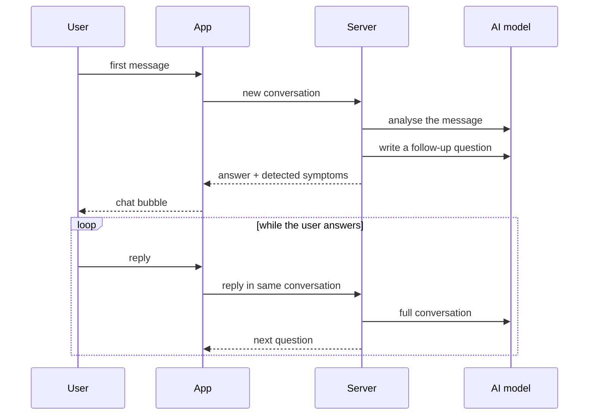
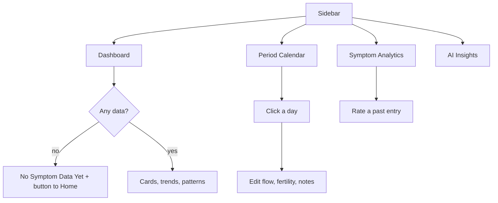

# ENDOless - UX Flows

## 1. Screens

| Screen | Route | What it is for | Who can open it |
|---|---|---|---|
| Login / Register | `/auth` | Two tabs: Login and Register | Anyone |
| Password recovery | `/auth/recovery` | Reset a password in 3 steps | Anyone (but see problem 1) |
| Onboarding | `/onboarding` | First setup, 3 steps | Logged-in users |
| Home | `/` | Log today's symptoms (form or chat) | Logged in + onboarding done |
| Dashboard | `/dashboard` | Charts and patterns over 7, 30 or 90 days | Logged in + onboarding done |
| Symptom Analytics | `/analytics` | Impact charts and personal ratings | Logged in + onboarding done |
| Period Calendar | `/calendar` | Cycle phases, flow and fertility data per day | Logged in + onboarding done |
| AI Insights | `/insights` | Correlations found by the AI | Logged in + onboarding done |
| Profile | `/profile` | Account settings | Logged in + onboarding done |
| Not found | any other URL | Error page | Anyone |

Navigation is a left sidebar with: Home, Dashboard, Symptom Analytics, Period Calendar, AI Insights, Profile, and a Logout button. The sidebar also shows the most recent symptom entries.

## 2. Rules that apply everywhere

**Route protection.** Every page marked "logged in" goes through the same check (`lib/protected-route.tsx`):

1. While the app is still checking the session, a spinner is shown.
2. No user: redirect to `/auth`.
3. User exists but `hasCompletedOnboarding` is false: redirect to `/onboarding`.
4. Otherwise the page is shown.

The `hasCompletedOnboarding` field is false by default for every new account, and it is set to true when onboarding is saved.

**Feedback.** Success and error messages appear as small toast notifications. Forms show validation errors under the field. Buttons show a spinner and are disabled while a request is running.

**Session.** After login the app stores a token in a cookie and also in `localStorage` as a fallback. Logout clears both.

## 3. Flow: create an account

Entry: `/auth`, Register tab.

1. The user enters Email, Password and Confirm Password.
2. Validation (shown under the fields): valid email, password at least 6 characters, both passwords identical.
3. Submit sends `POST /api/register`.
4. On success a toast says "Account created". The `/auth` page sees that a user exists and sends them to `/`.
5. Because onboarding is not done, the route protection sends them on to `/onboarding`.

Errors: a toast "Registration failed" with the message from the server (for example if the email is already used).

## 4. Flow: log in and log out

Entry: `/auth`, Login tab (the default tab). Title "Welcome back".

1. The user enters Email and Password (password at least 6 characters).
2. Submit sends `POST /api/login`. The token is stored (cookie + `localStorage`).
3. A toast says "Welcome back!" and the user goes to `/`. If onboarding is not finished they continue to `/onboarding`.

Errors: toast "Login failed" with the server message.

Logout: the Logout button in the sidebar sends `POST /api/logout`, clears the stored data, shows "Logged out" and goes to `/auth`.

## 5. Flow: onboarding

Entry: `/onboarding`, forced after the first login. A progress bar and the text "Step N of 3" are shown. The page redirects to `/auth` if nobody is logged in and to `/` if onboarding is already done.

| Step | Fields | Rules |
|---|---|---|
| 1. Basic information | Full Name, Age | Both required. Age input accepts 18 to 100 |
| 2. Menstrual cycle | Average Cycle Length (days), Average Period Length (days), Last Period Start Date | All required. Cycle length 21 to 40 (default 28). Period length 1 to 10 (default 5) |
| 3. Medical information | Diagnosed Condition, Common Symptoms | Both optional |

Step 3 details:

- Diagnosed Condition (dropdown): None / Prefer not to say, Endometriosis, PCOS, Adenomyosis, Uterine Fibroids, PID, Other, Not yet diagnosed.
- Common Symptoms (checkboxes, several allowed): Pelvic Pain, Back Pain, Heavy Periods, Fatigue, Bloating, Nausea, Headaches, Mood Swings, Insomnia, Bowel Issues.

Buttons: Continue on steps 1 and 2, Back from step 2, and "Complete Setup" on step 3.

On the last step the app sends `POST /api/onboarding`. The server saves the name and age on the user, sets `hasCompletedOnboarding` to true, and creates a cycle information record. The user then sees the toast "Onboarding complete!" and lands on `/`. If saving fails, the toast says "Failed to save your information. Please try again." and the user stays on the form.

The cycle information entered here is used later by the calendar to predict hormonal phases.

## 6. Flow: password recovery

Entry: `/auth/recovery`. A ghost button at the top goes back to `/auth`.

1. **Forgot Password.** The user enters their Email Address and sends it (`POST /api/auth/request-password-reset`). A toast says "If an account exists with this email, you'll receive a reset code." The same message is shown whether or not the account exists.
2. **Verify Reset Code.** The user enters the 6-digit code (`POST /api/auth/verify-reset-code`). The page refuses codes shorter than 6 characters.
3. **Reset Your Password.** The user enters New Password and Confirm Password (`POST /api/auth/reset-password`). The new password must be at least 8 characters and both fields must match.
4. **Password Reset Successful.** A confirmation card with a "Go to Login" button.

See problems 1 and 2 in section 13: this flow is not reachable from the login page, and on the server it is still a placeholder.

## 7. Flow: log symptoms with the quick form (Fast Questions)

Entry: Home (`/`). The top of the page says "Choose how you want to track your symptoms today" and offers two modes. Fast Questions is the structured form. It does not use the AI.

The form has three groups:

**Pain Tracking**
- Pain Impact: "How does your pain affect your daily activities?" with a pain intensity value (0 to 10), the type of pain (cramp, sharp, dull, throbbing, burning, other), the context (exercise, sitting, standing, stress, other) and the areas of life affected (Work/School, Household/Self-care, Social/Leisure, Physical Activity/Exercise, Intimacy/Relationships).
- Pain Location: Lower abdomen, Lower back, Pelvis, Other.

**Energy & Mood**
- Fatigue: "How is your energy level affecting you?"
- Anxiety/Mood: "How is your mood or anxiety affecting you?"

**Additional Symptoms** ("Choose all symptoms you're currently experiencing")
- Headache, Nausea, Bloating, Bowel issues, Cystitis/UTI, Sleep issues, Cognitive fog.

The impact cards use one common five-level scale:

| Level | Label | Description shown to the user |
|---|---|---|
| 0 | None | No interference |
| 1 | Mild | Noticeable but doesn't limit activity |
| 2 | Moderate | Some limitation; needs brief rest/pause |
| 3 | Severe | Significant limitation; must stop activity |
| 4 | Disabling | Cannot perform activity; needs help/rest |

Saving:

1. The user presses "Save Today's Symptoms".
2. If nothing meaningful is filled in (no pain impact, no pain type, no pain context and no impact area), a red toast says "Please select a functional impact level or at least one symptom type before saving." and nothing is sent.
3. Otherwise `POST /api/symptoms/fast` saves the entry. A toast says "Symptoms saved", the form is reset to empty, and the "recent symptoms" list in the sidebar is refreshed.
4. On a server error the toast says "Failed to save symptoms. Please try again."

## 8. Flow: log symptoms by talking (Speak Naturally)

Entry: Home (`/`), second mode. The user writes in a text box with the placeholder "Describe how you're feeling today...". Switching to this mode starts a new conversation.

1. **First message.** The app sends `POST /api/symptoms/natural`. The server creates the entry and the conversation, saves the user's message, asks the AI to analyse it (main symptom, context, related symptoms), asks the AI for one follow-up question, saves it, and returns it. The answer is displayed in a chat bubble. A "Symptoms recorded" block appears when an analysis is attached.
2. **Next messages.** Each reply goes to `POST /api/symptoms/natural/:id/reply`. The server checks that the conversation belongs to the user, saves the message, sends the whole conversation to the AI and returns a new follow-up question. No new analysis is made for replies.
3. While waiting, the input is disabled and a loading bubble is shown. The view scrolls to the latest message by itself.
4. Errors: toast "Failed to process your message. Please try again." (first message), "Failed to send your message. Please try again." (replies), or "Received incomplete data from server. Please try again."

## 9. Flow: consult the data

**Dashboard (`/dashboard`)**, title "Symptom Insights".
- Time range buttons: 7 days, 30 days (default), 90 days.
- Three summary cards: Pain Severity, Pain Location, Common Symptoms.
- "Symptom Trends" chart with two tabs: Energy Levels and Mood.
- "Detected Patterns".
- Empty state: "No Symptom Data Yet" with a "Go to Symptom Tracker" button.

**Symptom Analytics (`/analytics`)**, title "Symptom Analytics & Rating".
- "Health Metrics Dashboard" with tabs Symptom Impact and Your Ratings.
- Sections: Symptom Impact Over Time, Your Symptom Ratings, Most Common Symptoms, Symptom Trend Analysis, Symptom Details.
- The user can give a rating, with optional notes, to a past entry (`POST /api/symptoms/:id/rate`). Ratings are then charted and used to say whether things are getting better or worse. I did not check the exact scale of the rating.

**Period Calendar (`/calendar`)**, title "Cycle Calendar".
- "Hormonal Calendar": a colour-coded month view of cycle phases and symptoms. Phases are predicted from the onboarding data. A flow the user recorded for a day replaces the prediction for that day.
- Clicking a day opens "Cycle Information" for that day:
  - Period Flow (heavy, medium, light, spotting, none) and Override Hormonal Phase.
  - Fertility Tracking: Cervical Mucus, Cervical Position, Basal Temperature, Ovulation Test Result, and notes.
  - "Symptoms for This Day" and "Additional Symptoms".
- Saving updates the existing record for the day (`PATCH /api/period-flows/:id`) or creates one (`POST /api/period-flows`). If every field is empty, nothing happens and no message is shown.

**AI Insights (`/insights`).**
- Shows the AI correlation analysis (`/api/insights/correlations`). It needs a few saved entries before it can find anything.
- Two other blocks on the page are only marked "Coming Soon".

## 10. Flow: profile and account

Entry: `/profile`, title "Profile & Account Settings". Five blocks:

1. **Profile Information.** Name and Email. Saving sends `PATCH /api/profile/update`.
2. **Change Password.** Current Password, New Password, Confirm New Password (`POST /api/profile/change-password`).
3. **Account Recovery.** A "Forgot Password?" button that opens `/auth/recovery`.
4. **Data Export.** Text saying the user can download a copy of their data, and a "Request Data Export" button. In the code this button has no action attached.
5. **Delete account.** A confirmation dialog titled "Are you absolutely sure?". The user must type their own email. If it does not match, the toast says "Email mismatch" and nothing is deleted. If it matches, `DELETE /api/profile/delete` is sent and the toast says "Account deleted".

## 11. Where each flow touches the data

| Flow | API calls | Main tables |
|---|---|---|
| Register / login / logout | `/api/register`, `/api/login`, `/api/logout`, `/api/user` | users |
| Onboarding | `/api/onboarding` | users, cycle_info |
| Quick form | `/api/symptoms/fast`, `/api/symptoms/recent` | symptoms |
| Chat | `/api/symptoms/natural`, `.../:id/reply`, `.../:id/messages` | symptoms, natural_inputs, chat_messages |
| Dashboard, analytics | `/api/symptoms/all`, `/api/symptoms/:id/rate` | symptoms |
| Calendar | `/api/period-flows`, `/api/profile` | period_flows, cycle_info |
| Insights | `/api/insights/correlations` | symptoms |
| Profile | `/api/profile/*` | users |

## 12. How the pieces connect (user view)

The user's usual path is: register, onboarding, Home (log symptoms), then Dashboard, Analytics, Calendar and Insights to look at the results. Home does not lead to the results screens by itself. After saving, the user only sees a toast and an empty form.

## 13. Problems found

Ordered by how much they affect a user.

1. **No way to reach password recovery from the login page.** `/auth/recovery` is only linked from the Profile page, which needs a logged-in user. The Profile page even says to use the "Forgot Password" option on the login page, but there is no such option. Someone who forgot their password cannot find the flow.
2. **Password reset does not really work on the server.** No email is sent and no code is stored. The server accepts any code of 6 or more characters, and then changes the password of whatever email was given. So the screen promises a code that never arrives, and in the current state anyone who knows an email address could reset that account's password. This needs fixing before real use.
3. **Chat entries are not part of the structured data.** The quick form fills the structured record. The chat only stores text and an analysis in a separate field, so these entries do not feed the charts the same way.
4. **"Request Data Export" does nothing.** The button has no action, but the text next to it says a copy of the data will be generated.
5. **Two "Coming Soon" blocks** remain on AI Insights.
6. **Password rules differ.** 6 characters at register and login, 8 characters when resetting a password.
7. **No visible navigation on small screens.** The sidebar is hidden below the `md` breakpoint and I did not find another menu in `app-layout.tsx`. This needs to be checked on a phone.
8. **Calendar save fails silently** when every field is empty.
9. **Dead end after saving symptoms.** There is no link to the results.
10. **Silent AI failure.** If the AI call fails, the server returns a generic sentence that looks like a normal assistant answer.
11. **English only.** All texts are hard-coded in English.

Not a UX point, but worth passing on to the team: the server has a temporary login fallback that trusts a `?userId=` value in the URL (commented as temporary in `auth.ts`), and the JWT secret falls back to a fixed value when the environment variable is missing. Both matter a lot because the app stores health data.
